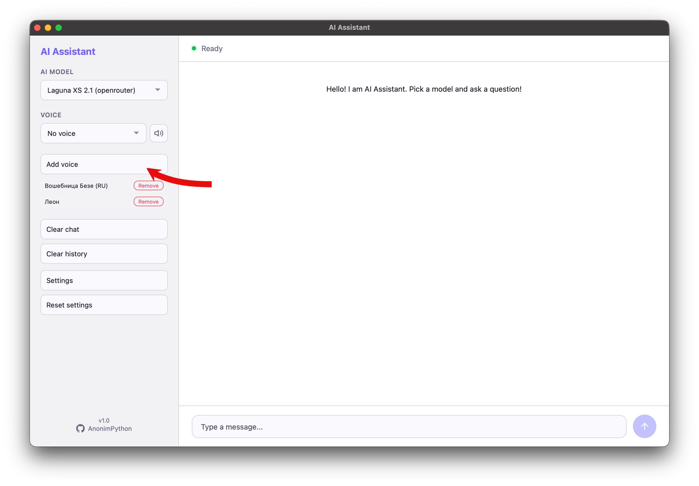
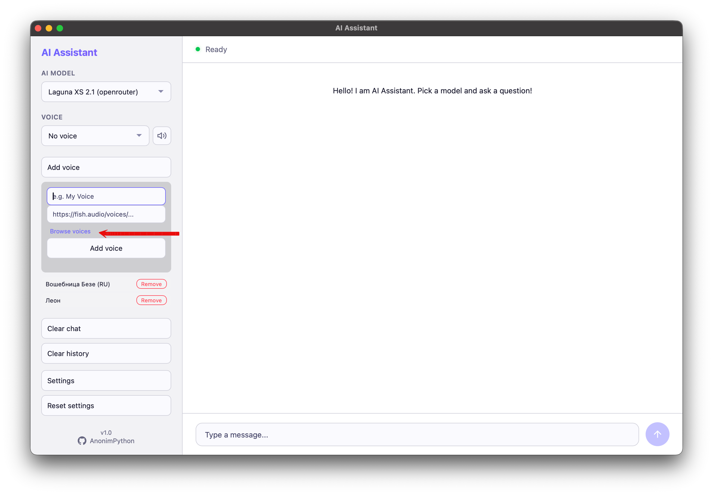
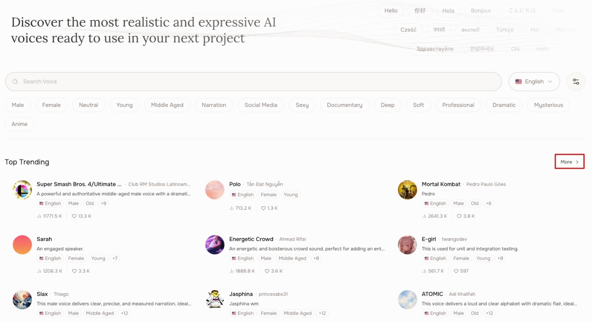
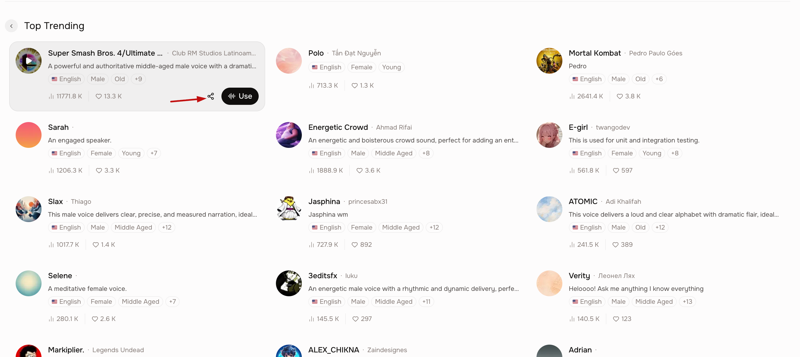
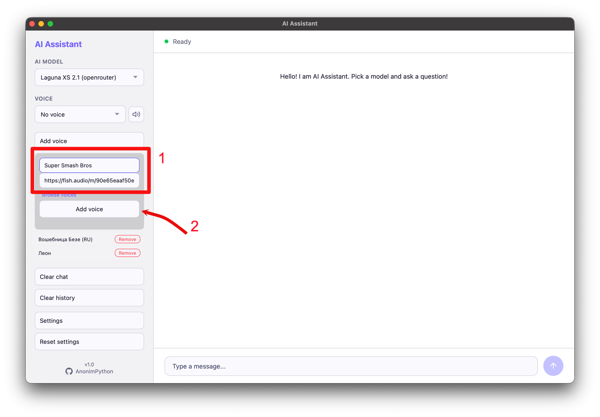

# AI Assistant

Multi-model AI assistant with voice output and a modern **Aurora Glass** interface. Works as a **web app** and a **desktop app**.

**App interface languages:** English, German, French, Portuguese, Russian

## Highlights

- **Aurora Glass UI** — responsive sidebar, glass panels, light/dark themes, mobile layout
- **Secure API keys** — stored in the OS keychain when available, with a local fallback
- **Web search with citations** — grounded answers through the OpenRouter web plugin
- **Image search in the browser** — requests like “find an iPhone photo” open the real image search
- **Voice marketplace** — browse, filter, preview and add Fish Audio voices inside the app
- **OpenRouter OAuth** — one-click onboarding; only the OpenRouter key is required
- **Free model browser** — discover and add free OpenRouter models with one click
- **Offline voice input** — local faster-whisper speech recognition
- **Desktop commands** — open websites, search the web/images, minimize all windows
- **2 run modes** — web and native desktop window via pywebview
- **Docker-ready** — container image included
- **5 UI languages** — EN, DE, FR, PT, RU

## Quick start

```bash
git clone https://github.com/AnonimPython/AI-Assistant.git
cd AI-Assistant
```

### 1. Install dependencies

```bash
pip install -r requirements.txt
```

### 2. Launch

**Web version** (open http://localhost:5066):

```bash
python app.py
```

**Desktop version**:

```bash
python desktop.py
```

**Docker**:

```bash
docker build -t ai-assistant .
docker run -d -p 5066:5066 ai-assistant
```

### 3. First launch

Use **Continue with OpenRouter** for one-click OAuth setup, or paste a key manually.
Only the OpenRouter key is required; Fish Audio and HuggingFace are optional.

| Service     | Required | Where to get                           |
| ----------- | -------- | -------------------------------------- |
| OpenRouter  | Yes      | https://openrouter.ai/keys             |
| Fish Audio  | Optional | https://fish.audio/app/developers/     |
| HuggingFace | Optional | https://huggingface.co/settings/tokens |

## Screenshots

### Aurora Glass interface

| Chat, citations & web search | Settings & secure key storage |
| ---------------------------- | ----------------------------- |
|  |  |

| Voice marketplace | Free model browser |
| ----------------- | ------------------ |
|  |  |

| OpenRouter OAuth onboarding | Mobile layout |
| --------------------------- | ------------- |
|  |  |

### Web search composer


## Web search & image search

Enable the globe button in the composer to ground answers with the OpenRouter web plugin. The answer includes clickable source citations from the `url_citation` annotations.

When you ask for a photo, picture or image, the assistant opens Google Images in your default browser with the extracted query. Example: “найди фотографию айфона” → Google Images for “айфона”.

Web search uses OpenRouter credits even with free models. See [OpenRouter web search pricing](https://openrouter.ai/docs/features/web-search).

## Secure API key storage

API keys are saved in the operating system keychain through `keyring`:

- macOS — Keychain
- Windows — Credential Locker
- Linux — Secret Service / KWallet when available

On first launch after upgrading, existing plaintext keys are migrated from `~/AI Assistant/config.json` into the keychain and removed from the JSON file. In headless/Docker environments without a keychain backend, the app falls back to local JSON storage and shows a warning in Settings.

## Features

- **Multiple AI models** — OpenRouter + HuggingFace
- **Free models browser** — add any free OpenRouter model with one click
- **Voice output** — 40+ built-in voices via Fish Audio TTS
- **Voice marketplace** — search and preview catalog voices before adding
- **Multilingual UI** — 5 languages (EN, DE, FR, PT, RU)
- **Markdown rendering** — AI responses rendered with full markdown support
- **Auto-setup** — OpenRouter OAuth or manual key entry

## How to add a custom voice

Add any voice from Fish Audio to your assistant. The screenshots below walk through the full process.

| Step | Screenshot |
|------|------------|
| 1 — Find a voice on fish.audio |  |
| 2 — Click the voice card |  |
| 3 — Copy the voice URL |  |
| 4 — Open Add voice in app |  |
| 5 — Paste link and save |  |

**Alternative:** Open the app, go to Settings → Add voice, and click “How to add a voice” for an in-app guide with the same screenshots.

---

## Build exe/dmg

### Windows

**One-liner** (run from project folder — puts `.exe` on Desktop):

```cmd
pip install pyinstaller && pyinstaller --noconfirm --onedir --windowed --name "AI Assistant" --icon source/static/app_img/icon.ico --add-data "source/templates;templates" --add-data "source/static;static" --add-data "source/translations.py;." --add-data "source/config_manager.py;." --version-file version_info.txt main.py && xcopy /E /I "dist\AI Assistant" "%USERPROFILE%\Desktop\AI Assistant" && echo Done — .exe is on your Desktop!
```

### macOS

```bash
cd build
chmod +x build_macos.sh
./build_macos.sh
```

### Linux

```bash
make build-exe
```

Output files appear in `dist/` folder.

---

## Test models

Check which models are working:

```bash
python source/test_models.py
```

Broken models are automatically commented out in config.

---

## Docker

```bash
# Build
docker build -t ai-assistant .

# Run
docker run -d -p 5066:5066 --name ai-assistant ai-assistant

# Stop
docker stop ai-assistant
```

---

## Roadmap

- **More AI providers** — Anthropic, Groq, Together AI, etc.
- **Website embedding** — embeddable widget for third-party sites
- **Conversation memory** — long-term context and summary-based memory
- **Multi-session** — multiple independent chat sessions
- **Plugin system** — custom tools and integrations
- **macOS native app** — standalone .app bundle with native UI (beyond pywebview)
- **Computer Use** — screen understanding, mouse/keyboard control and browser automation

---

## Antivirus

PyInstaller may cause false antivirus positives. Recommendations:

- Use Docker to avoid this issue
- For Windows: add program folder to Defender exclusions
- For macOS: `xattr -cr /path/to/app` after unpacking

---

## Project structure

```
ai_assistant/
├── app.py              # Flask web server
├── desktop.py          # Desktop wrapper (pywebview)
├── test_models.py      # Model testing
├── config_manager.py   # API key and keychain management
├── requirements.txt    # Dependencies
├── Dockerfile          # Docker container
├── Makefile            # Build commands
├── README.md           # English documentation
├── README_RU.md        # Russian documentation
├── templates/          # HTML templates
│   ├── index.html      # Chat interface
│   └── setup.html      # Setup / OAuth page
├── static/             # Static files
│   ├── css/style.css
│   ├── js/app.js
│   ├── how_to_add_voice/  # Voice guide screenshots
│   └── repo images/       # App screenshots for README
└── build/              # Build scripts
    ├── build_windows.bat
    ├── build_macos.sh
    └── installer.iss
```

---

## Tech stack

- **Backend** — Python Flask
- **Frontend** — Vanilla JS, CSS custom properties, Aurora Glass design system
- **Markdown** — marked.js (CDN)
- **TTS** — Fish Audio API
- **STT** — faster-whisper (local)
- **Security** — OS keychain via `keyring`
- **Web grounding** — OpenRouter web plugin
- **Desktop** — pywebview
- **Docker** — multi-stage build

---

## 📖 Russian documentation

👉 [Полная документация на русском →](README_RU.md)
